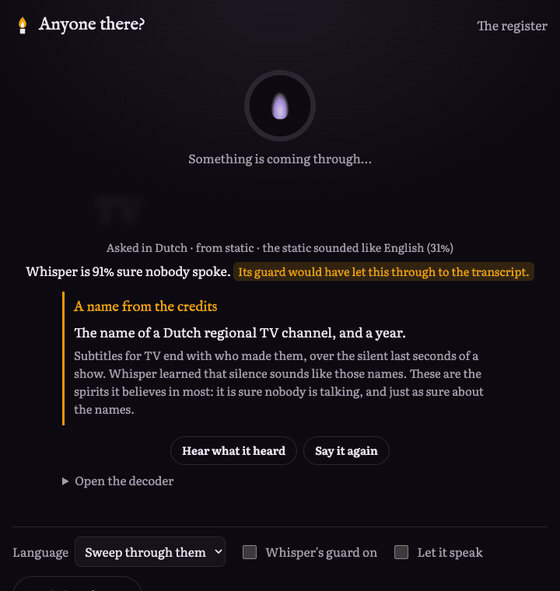
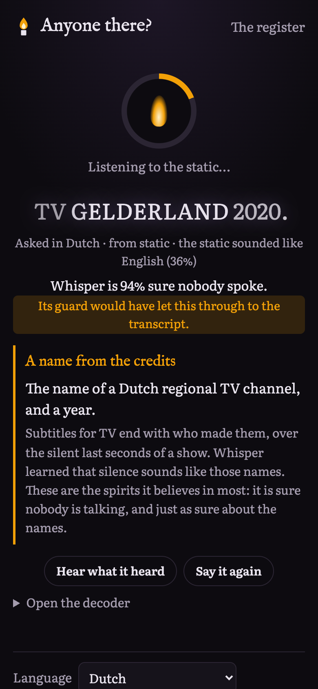
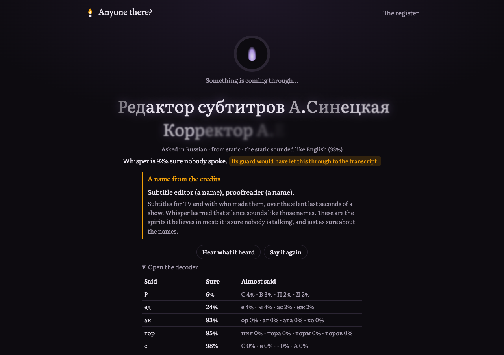

# Anyone there?

[](https://github.com/abjt01/anyone-there/actions/workflows/ci.yml)
[](https://render.com/deploy?repo=https://github.com/abjt01/anyone-there)

A spirit box made of Whisper.

Whisper is the open speech model inside a lot of transcription apps. Give it an empty room and it still hears things: the names of subtitle editors, a Dutch TV channel, "thanks for watching this video" in Japanese, a Tamil voice calling "amma, amma". It normally runs with guards that throw most of these away. This app runs Whisper in your browser with those guards switched off, points it at a quiet room or at static, and lets whatever it hears come through, one language at a time, the way a ghost hunter's spirit box sweeps radio stations.

Then it tells you where each spirit comes from.

**Try it:** [anyone-there.onrender.com](https://anyone-there.onrender.com). The first visit downloads the model and its runtime once (about 100 MB); after that it works with the internet off.



<table>
  <tr>
    <td></td>
    <td></td>
  </tr>
</table>

## What it hears

I let Whisper base listen to 504 windows of nothing: digital silence, and white, pink and brown noise and mains hum at different levels, eight seconds each, in 24 languages. It said something in every one. Some of what came back:

| Language | It said | Meaning | Whisper's own guard |
|---|---|---|---|
| Dutch | TV GELDERLAND 2020. | a regional TV channel, and a year | let it through, 16 of 16 times |
| Russian | Редактор субтитров А.Синецкая Корректор А.Егорова | subtitle editor (a name), proofreader (a name) | let it through, 5 of 5 |
| Turkish | Bu dizinin betimlemesi TRT-8'ne yaptırılmıştır. | the audio description of this series was made for TRT | caught it, only just: average log-probability −1.08 against a cut-off of −1, and once −1.005 |
| Japanese | さて、この動画を見てくれてありがとう! | well, thanks for watching this video! | caught it |
| English | you | | caught it 14 of 15 times |
| Tamil | …இருக்கிறாய் அம்மா | …amma (mother) | let it through 3 of 4 |
| Chinese | 我以为你还没见到我 | I thought you hadn't seen me yet | caught it |
| Vietnamese | Chúng ta sẽ ở đây | we will be here | caught it |

All of it is on the [register page](https://anyone-there.onrender.com/register/), built from [`data/sweep.json`](data/sweep.json).

Three things stood out:

- **The spirits with names are the ones Whisper believes in.** Subtitles for TV end with the names of the people who made them, over the silent last seconds of a show, so Whisper learned that silence sounds like those names. Its guard drops a window only when it's sure nobody is speaking (no-speech probability over 0.6) *and* the words are shaky (average log-probability under −1). On the credits, Whisper is over 90% sure nobody spoke, and then it says the job titles with 95–100% confidence. Both checks have to fail, so the credits walk straight through. The surnames are where it wavers: the sweep heard two different Russian editors.
- **60 of the 504 windows, all of them with nothing in them, would reach a transcript with Whisper's default settings.** In every one, Whisper itself was at least 82% sure nobody had spoken.
- **Asked to pick a language for the hiss, it usually picks Norwegian Nynorsk** (62% of the windows), and in Nynorsk the static says "1.5%".

## How it works

1. **Listen.** Eight seconds from the microphone (with the browser's noise suppression off, because the spirits live in the hiss), or eight seconds of seeded static.
2. **Ask Whisper, with the guards off.** Whisper base runs in a Web Worker with [Transformers.js](https://github.com/huggingface/transformers.js) and ONNX Runtime on WebAssembly, on several threads. One decoder step after `<|startoftranscript|>` gives what openai/whisper calls the no-speech probability and the language guess. Then the decoder runs with a logits processor of my own in the loop (`lib/medium.ts`). It bans brackets and music notes, which is what OpenAI's own decoder does and Transformers.js doesn't, so the spirits have to use words instead of "[water running]". It picks each token, and it writes down the four voices that almost spoke at every step.
3. **Judge it the way Whisper would.** `lib/guard.ts` runs the same three checks as openai/whisper's `transcribe.py`: no-speech over 0.6, average log-probability under −1, and a zlib compression ratio over 2.4 for text that repeats itself. Nothing is thrown away; the app just tells you whether Whisper would have printed it, tried again, or dropped it. Switch "Whisper's guard on" and watch the dropped ones turn into "Nobody's here." The credits still get through.
4. **Name it.** If the words are in the register, you get what they mean and why Whisper says them. "Open the decoder" shows how sure it was of every piece and what it almost said instead.

When someone in the room really talks, Whisper knows: the no-speech probability falls, and the app says "a living voice" and doesn't treat it as a spirit.

## Why open

- **You can only meet these ghosts if you can open the model.** The no-speech probability, the language guess on static, the four runners-up at every token, banning tokens, choosing the token yourself: none of that comes back from a hosted speech-to-text API. You get text. Here you get the decoder.
- **The ghosts can be checked.** Same weights, same static, same spirit, every time. `npm run sweep` rebuilds the register on your own machine, and the tests check it against the real model.
- **A microphone left on in a dark room stays in that room.** Whisper runs in the browser. Nothing is uploaded, there's no account, and it works offline.
- **They can't be exorcised quietly.** A hosted model can be patched so the credits stop showing up, and you'd never know they'd been there. These weights are fixed, and they're in this repo.

## Run it

```bash
npm install
npm run dev            # http://localhost:4320
```

The model is in `public/models/whisper-base` (8-bit ONNX from [onnx-community/whisper-base](https://huggingface.co/onnx-community/whisper-base)), and ONNX Runtime's wasm is copied from `node_modules` at build time, so the page never fetches anything from another site.

## Tests

```bash
npm run lint && npm run typecheck
npm test              # the decoder hook, Whisper's guard (checked against Python's zlib), static, the register against the sweep
npm run test:model    # the real model in Node: the Dutch credit, the Russian editors, "you", Nynorsk static, a living voice, repeatability
npm run build
npm run test:e2e      # real Chrome running the real model: every page at 320–1280px, static and room séances, a living voice, a blocked mic, offline
npm run sweep         # rebuild data/sweep.json (about six minutes)
```

The room tests give the page a microphone that plays a recording (a quiet room, or a synthetic voice saying "Is anyone there?"), so everything after `getUserMedia` is the real capture path.

## Layout

```
app/                 the séance, the register
components/Seance    the one screen: listening, the voice, the guard, the decoder, tonight's register
lib/
  engine.ts          Whisper with the guards off: no-speech, language, the decode loop
  medium.ts          the logits processor that picks each token and remembers what almost won
  guard.ts           openai/whisper's three checks
  register.ts        the known spirits and what they mean
  noise.ts           seeded silence, hiss and hum
  browser.ts         the worker, the microphone, static, replay, the voice
  spirit.worker.ts   where Whisper lives
data/sweep.json      504 windows of nothing, and what Whisper said to each
```

## Limits

- It's Whisper base, the small one. Bigger Whispers have their own ghosts, but they're 3 to 20 times the download.
- The voice is your device's own speech engine, so some languages have no voice on some devices. The words still show.
- The translations in the register are mine. The meanings are plain; the "where it comes from" is the most likely story, not something OpenAI has published.

## Credits

Whisper by OpenAI (MIT). The ONNX conversion by onnx-community. Transformers.js by Hugging Face (Apache 2.0), ONNX Runtime by Microsoft (MIT).

## License

[MIT](LICENSE)
